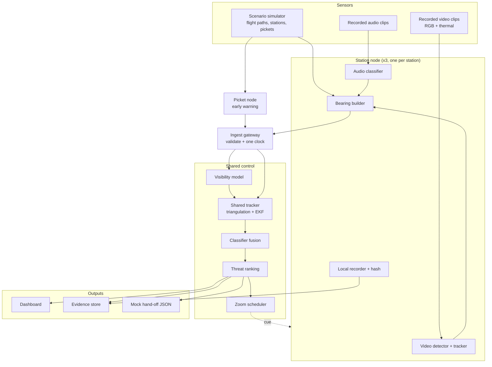

# Architecture — C-UAS Detection Demo

> **How the demo is built**: components, data flow, folders, messages and tech stack.
> Algorithms and the UI are explained in `design.md`.

## 1. Big picture

The demo copies the real system's architecture. The only difference is that some parts are **simulated** instead of real hardware.



## 2. Real vs simulated

| Part | In the demo | In the real system later |
| --- | --- | --- |
| Flight paths | Simulator (YAML scenarios) | Real drones |
| Station geometry and bearings | Simulator computes bearing + noise | Real cameras and microphone arrays |
| Video detection | **Real model** on recorded clips | Same model on live camera streams |
| Audio classification | **Real model** on recorded clips | Same model on live microphones |
| Acoustic direction (DOA) | Simulator computes bearing + noise | GCC-PHAT on real microphone array |
| Pickets | Simulator triggers by distance | Real picket units |
| Zoom camera | Simulated pointing; with recorded media, a held-out RGB clip as if 4× closer | Real PTZ camera |
| Site map | Local vector drawing of the fictional site from `site.yaml` ([mapping.md](mapping.md)) | Surveyed, client-approved map with MapLibre GL JS and self-hosted PMTiles ([mapping.md](mapping.md)) |
| Time sync | One simulated clock | PTP hardware |
| Message bus | In-process async queues | Network bus (MQTT or SAPIENT) |
| Hand-off | JSON file export | Link to MOI / PSS / MoD operations room |

**Key rule:** every simulated part sits behind an interface. Real hardware later replaces the implementation, not the interface.

## 3. Folder layout

```
cuas-demo/
├── CLAUDE.md                 # loaded by Claude Code every session
├── docs/                     # prd, architecture, design, mapping, rules, phases, memory
├── config/
│   ├── site.yaml             # stations, pickets, zones, camera specs
│   ├── media_manifest.yaml   # recorded clips: hashes, labels, train/val/test split (no media)
│   └── scenarios/            # s1_owa_wave.yaml, s2_stadium_quad.yaml, ...
├── src/cuas/
│   ├── schemas/              # Pydantic message models (one file per message type)
│   ├── bus/                  # message bus interface + in-process implementation
│   ├── clock.py              # single simulated clock
│   ├── config.py             # typed site config, truth-free scenario metadata
│   ├── geometry.py           # bearing calculation, shared by simulator and tracker
│   ├── sim/                  # scenario loader, trajectories, station + picket simulation, zoom cameras, ground truth log, hybrid media and sound links, SNR mixing
│   ├── station/              # video detector, local tracker, M-of-N, mel and audio classifier, recorder
│   ├── gateway/              # validation and rejection log
│   ├── pipeline.py           # wires the gateway and control layer between buses; never sees ground truth
│   ├── control/
│   │   ├── triangulation.py  # rays to a 3D point, with the A5 checks
│   │   ├── kalman.py         # constant-velocity filter
│   │   ├── association.py    # bearing gate and Hungarian assignment
│   │   ├── tracker.py        # shared 3D tracker (A6)
│   │   ├── sectors.py        # acoustic sector tracks: wedges, never a position
│   │   ├── layer.py          # batches the gateway's output for the trackers; zoom bearings never set a batch
│   │   ├── behaviour.py      # movement features, move clue, fitted velocity for time to impact
│   │   ├── classify.py       # fusion of look + movement + sound
│   │   ├── threat.py         # zones, time-to-impact, score, level
│   │   ├── alerts.py         # alert identity, stale and re-acquisition rules
│   │   ├── coverage.py       # coverage % from reported visibility
│   │   └── scheduler.py      # zoom camera assignment
│   ├── evidence/             # store, hashing, tamper-evident log, hand-off export
│   ├── dashboard/            # FastAPI app, WebSocket, static HTML/JS
│   └── metrics/              # run report, evaluators (the only readers of ground truth): bearings and tracks; splits, label reader, recorded-media report
├── scripts/
│   ├── run_demo.py           # python scripts/run_demo.py --scenario s1
│   ├── download_data.py      # fetch public datasets into data/
│   ├── prepare_media.py      # read labels, write config/media_manifest.yaml
│   ├── train_detector.py     # fine-tune a detector; resumes after a kill; CPU by default, opt-in CUDA (docs/colab_gpu.md)
│   ├── train_audio.py        # train the audio classifier
│   ├── evaluate_media.py     # held-out reports in runs/eval/
│   └── compare_zoom.py       # paired S3 run at 0, 1 and 2 zoom cameras, recorded media
├── tests/                    # pytest, mirrors src/ layout
├── data/                     # datasets (gitignored)
├── models/                   # trained weights (gitignored)
└── runs/                     # outputs per run: evidence, logs, metrics (gitignored)
```

## 4. Messages

All parts talk only through typed messages on the bus. This mirrors the real system's ingest gateway and keeps parts independent. Field names are inspired by the SAPIENT (BSI Flex 335) style: detections and tracks, not raw video.

| Message | From → To | Key fields |
| --- | --- | --- |
| `SensorStatus` | station, picket → gateway | sensor_id, ok, visibility_factor, t |
| `BearingDetection` | station → gateway | station_id, sensor (rgb, thermal, acoustic, zoom), t, azimuth_deg, elevation_deg, sigma_deg, class_probs, snapshot_ref |
| `PicketAlert` | picket → gateway | picket_id, t, bearing_deg (coarse), loudness, engine_type_probs |
| `Track` | tracker → classify, threat, dashboard | track_id, t, position_enu_m, velocity_mps, covariance, n_stations, status (tentative, confirmed, lost) |
| `SectorTrack` | tracker → classify, threat, dashboard | sector_id, t, sensor_id, origin_enu_m, bearing_deg, half_width_deg, status (active, lost) |
| `TrackClass` | classify → threat, dashboard, evidence | track_id, t, p_drone, p_bird, p_attack_drone, evidence (look, move, sound), looks (latest frame per camera) |
| `ThreatAssessment` | threat → scheduler, dashboard, evidence | track_id, t, score, level, zone, time_to_impact_s, reasons, alert_id |
| `CoverageStatus` | visibility → scheduler, dashboard | t, coverage_pct, warning |
| `ZoomTask` | scheduler → station | station_id, t, camera_id, track_id, azimuth_deg, elevation_deg |
| `EvidenceRecord` | evidence → dashboard | alert_id, track_id, clip_path, sha256, prev_hash |
| `RejectedMessage` | gateway → log | reason, raw |

Rules:

- Times are seconds on the single simulated clock (`clock.py`), never wall-clock inside the pipeline.
- Positions use a local **ENU** frame (east, north, up) in metres, origin at the site centre.
- Angles: azimuth 0° = north, clockwise; elevation 0° = horizon.
- Ground truth (true positions, target IDs and target types) never goes on the bus. It stays in `cuas.sim`, and only `cuas.metrics` reads it.

## 5. Process model

- One Python process, `asyncio`.
- Each component is an async task that subscribes to topics on the bus and publishes results.
- The demo runs three in-process buses: **sensor** (simulator to gateway), **ingest** (gateway to control layer) and **control** (tracks and sectors onward). Each stage reads one and writes the next, so nothing reaches the tracker without passing the gateway, the observation digests stay unchanged, and the stages shut down in order.
- The bus interface has `publish(topic, msg)`, `subscribe(topic)` and `close()`. `subscribe("#")` receives every message in publish order. The in-process version uses `asyncio.Queue`. An MQTT version can be added later without touching components.
- The simulator drives the clock. It can run faster than real time for tests, or at real time for the live demo.

## 6. Tech stack

| Need | Choice | Why |
| --- | --- | --- |
| Language | Python 3.11+ | ML ecosystem; team skill |
| Env and deps | `uv` (or pip + venv) | Fast, reproducible lock file |
| Messages | Pydantic v2 | Typed, validated messages |
| Video detection | `torchvision` SSDLite320 MobileNetV3, fine-tuned | BSD-3-Clause code and light on CPU. Small targets are its weak point; YOLOX-Nano (Apache-2.0) is the fallback |
| Video decoding | `av` (PyAV) | Reads the recorded clips |
| Video tracking | Own two-stage association, ByteTrack's method | `supervision` 0.31.5 no longer includes ByteTrack, and its replacement pulls in many packages |
| Audio | `numpy` mel-spectrogram + small PyTorch CNN | Light and trainable on a laptop; current `librosa` needs Python 3.12 |
| Tracking maths | `numpy`, `scipy` (Hungarian assignment) | The constant-velocity filter is about 25 lines of numpy, so `filterpy` is not needed; `scipy` is already locked |
| Config | YAML + Pydantic settings | One place for site and scenario values |
| Dashboard | FastAPI + WebSocket + plain HTML/JS canvas; a local vector site map ([mapping.md](mapping.md)) | Real-time, no heavy frontend build, works offline |
| Evidence | SQLite + files + SHA-256 hash chain | Simple, tamper-evident |
| Tests | `pytest`, `pytest-asyncio` | Standard |
| Lint/format | `ruff` | One fast tool |

## 7. Data

- Sources, licences and recording rights are in `data/README.md`.
- Video and most audio: the Svanström Drone Detection Dataset (RGB, thermal, audio; drones, birds, airplanes, helicopters).
- Engine audio: CC0 clips from FSD50K, as a proxy. No public recordings of one-way attack drones were found.
- All data lives in `data/` (gitignored), fetched by `scripts/download_data.py`.
- No client or Saudi site footage is used in the demo.

## 8. Path from demo to real system

1. Replace `sim/station` bearings with real camera and microphone nodes publishing the same `BearingDetection` messages.
2. Replace the in-process bus with a network bus.
3. Replace the simulated clock with PTP-synced timestamps.
4. Add real hand-off, NCA security controls and Camera Law-compliant evidence storage.

No changes are needed in `control/` if the messages stay the same.
